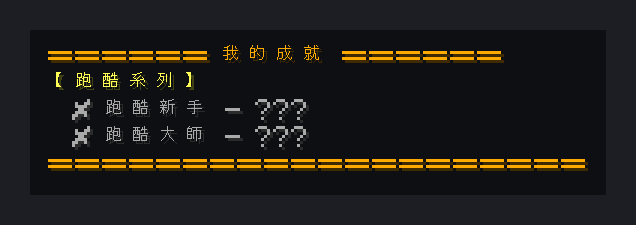

# 成就顯示

[English](README.md) | **繁體中文**

簡易自訂成就系統：玩家拿到跑酷獎勵物品時解鎖成就，並以全服標題、聊天廣播、音效與 DiscordSRV 訊息公告。

> 本儲存庫包含同一個腳本的兩個版本：**繁體中文（zh-TW）** 是作者伺服器實際使用的原始版本；**English** 為完整英文翻譯版（指令、訊息與變數名稱皆為英文），功能相同。

<!-- BEGIN LIVE SCREENSHOTS -->

## 畫面預覽

*全新玩家執行 `/成就`（別名 `/achievement`），因此所有成就都還是未解鎖狀態。*

> 這些是實機擷取後重繪的畫面，不是原生客戶端截圖。流程為：無頭客戶端登入實機 Paper 26.2 伺服器觸發腳本，再以官方 Minecraft 26.2 客戶端素材忠實重繪伺服器回傳的方塊／介面資料。Mojang/Microsoft 的圖像資產不屬於本專案程式碼授權範圍。

<!-- END LIVE SCREENSHOTS -->

## 功能特色

- 兩個跑酷成就，每位玩家各只能解鎖一次
- 全服玩家看到標題與成就音效，並發送聊天與 Discord 廣播
- `/成就` 查看自己已解鎖的成就
- 管理員可給予或重置成就
- 可重複利用的 `showAchievement(玩家, 標題, 說明)` 函式，方便加入新成就

## 需求

- [Paper](https://papermc.io/) 伺服器（開發環境 Paper 26.2 / Minecraft 26.2）
- [Skript](https://github.com/SkriptLang/Skript)（開發環境 2.16.2）
- [DiscordSRV](https://github.com/DiscordSRV/DiscordSRV)（選用，用於 Discord 公告）

## 安裝

1. 先安裝[需求](#需求)中列出的插件。
2. 下載**其中一個**版本：

   | 版本 | 檔案 |
   |---|---|
   | 繁體中文（原始版本） | [`zh-TW/成就顯示.sk`](zh-TW/%E6%88%90%E5%B0%B1%E9%A1%AF%E7%A4%BA.sk) |
   | English（英文） | [`en/achievement-display.sk`](en/achievement-display.sk) |

3. 把 `.sk` 檔案放進伺服器的 `plugins/Skript/scripts/`。
4. 執行 `/sk reload 成就顯示`（請換成你放入的檔名），或重新啟動伺服器。

> [!IMPORTANT]
> **只能安裝其中一個版本。** 兩個版本是同一個腳本的不同語言，同時載入會互相衝突或重複執行。

## 指令

| 指令（中文版） | 英文版 | 說明 | 權限 |
|---|---|---|---|
| `/成就` 別名：`/achievement` | `/achievements` 別名：`/achievement` | 查看自己的成就 | 所有人 |
| `/重置成就 <玩家>` | `/resetachievements <player>` | 重置玩家的成就 | OP |
| `/給予成就 <玩家> <成就ID>` | `/giveachievement <player> <id>` | 給予 `parkour.beginner` 或 `parkour.master` | OP |

## 設定

- 成就由點擊 [skript-parkour-reward-chest-refill](https://github.com/Im-Tim-mI/skript-parkour-reward-chest-refill) 的獎勵物品觸發：名為 `§b跑酷能手` 的指南針與名為 `§b跑酷高手` 的地獄之星（英文版為 `§bParkour Adept`、`§bParkour Expert`）。若要改名，兩個腳本需同步修改。

## 注意事項

- 沒有安裝 DiscordSRV 時 `discord broadcast` 指令只會執行失敗；不使用的話可刪除該行。
- 成就進度存放在 `{achievement.parkour.*::<uuid>}`，兩個版本共用相同變數。

## 相關專案

- [skript-parkour-reward-chest-refill](https://github.com/Im-Tim-mI/skript-parkour-reward-chest-refill)－主世界跑酷獎勵寶箱填充
- [skript-special-item-lock](https://github.com/Im-Tim-mI/skript-special-item-lock)－特殊物品封鎖系統

## 授權

**MIT + Commons Clause**，完整條款請見 [LICENSE](LICENSE)。

- ✅ 可自由使用、複製、修改與分享本腳本。
- ✅ 本授權明確允許在收費或營利的 Minecraft 伺服器上安裝與運行本插件（含修改版）。
- ❌ 禁止的僅限於直接或間接販售本插件本體、修改版本，或以付費方式取得其檔案或原始碼。

Copyright (c) 2026 廷廷小教室、廷廷的家（Tim945）
